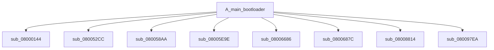

# CALL_GRAPH

Полный граф: `disassembly/cross_references.csv` (типы call/tailcall/funcptr_literal/vector:*/jumptable_target) и поля `calls/called_by/tail_calls/indirect_calls` в `functions.json`. Косвенных вызовов (BLX Rx): 33 (адреса — в `indirect_calls`), таблиц переходов TBB/TBH: 1.

## Образ B — старт и главный цикл (1 уровень)

```mermaid
graph TD
  f8010144["B_main"] --> f8010374["NVIC_SetVectorTable"]
  f8010144["B_main"] --> f8014250["SD_ReadConfig_or_Index"]
  f8010144["B_main"] --> f8014702["SD_to_NAND_Loader"]
  f8010144["B_main"] --> f80148EA["Show_NAND_Image"]
  f8010144["B_main"] --> f8014946["Show_All_Images_Test"]
  f8010144["B_main"] --> f8014CFA["SD_Init"]
  f8010144["B_main"] --> f801555A["LCD_Init_ILI9488"]
  f8010144["B_main"] --> f8016A2C["Touch_GPIO_Init"]
  f8010144["B_main"] --> f80171F4["sub_080171F4"]
  f8010144["B_main"] --> f8017222["sub_08017222"]
  f8010144["B_main"] --> f801723A["sub_0801723A"]
  f8010144["B_main"] --> f801728C["TIM2_Tick_Init"]
  f8010144["B_main"] --> f801730E["delay_ms_tim2"]
  f8010144["B_main"] --> f801738A["USART1_Init_115200"]
  f8010144["B_main"] --> f8017520["Buzzer_TIM5_PWM_Init"]
  f8010144["B_main"] --> f80175C0["DAC_Init_PA4"]
  f8010144["B_main"] --> f801762C["NAND_GPIO_FSMC_Init"]
  f8010144["B_main"] --> f8017A82["NAND_Erase_Progress"]
  f8010144["B_main"] --> f8018430["sub_08018430"]
  f8010144["B_main"] --> f8018480["sub_08018480"]
  f8010144["B_main"] --> f801AD66["Main_Task_UI"]
  f8010144["B_main"] --> f801C3FC["Main_Task_Comm_Parse"]
  f8010144["B_main"] --> f801CF40["Param_ReadFlash"]
  f8010144["B_main"] --> f801D074["SystemInit"]
```

## Образ A — bootloader main (1 уровень)

## Критические цепочки (подтверждены чтением)
* Reset B: `0x0801CFB0` →(blx) `SystemInit 0x0801D074` →`SetSysClock 0x0801CFD4`; затем `bx 0x08010131`→ `B_startup_stub 0x08010130` → `scatterload 0x0801DBBC` (обработчики 0x0801E08A copy / 0x0801E14C zero) → `0x08010138` → `B_main 0x08010144`.
* Показ картинки: `Show_NAND_Image 0x080148EA` → `NAND_ReadPageAt 0x08017BDE` → `NAND_ReadPage 0x08017810` → `LCD_SetWindow_Wrapper 0x0801581A` → `LCD_WriteBuffer 0x08015914`.
* SD init: `SD_Init 0x08014CFA` → `SD_SPI2_Init 0x08014AC8` → `GPIO_Init 0x08011112`/`SPI_Init 0x080115C8`; обмен `SD_SPI_ReadWriteByte 0x08014BE8`.
* Тач: `Touch_Poll 0x08016BB0` → `XPT2046_ReadXY_raw 0x0801662A` → `XPT2046_Read_Filtered 0x080165C6` → `XPT2046_ReadADC 0x08016578` → `XPT2046_SPI_Transfer 0x08016510`.
* UART RX: IRQ `0x08017476` → `uart_rx_push 0x08017366`; потребитель `uart_get_line 0x0801749E` ← `Main_Task_Comm_Parse 0x0801C3FC`.
* Загрузка ресурсов: `B_main` → `NAND_Erase_Progress 0x08017A82` → `SD_to_NAND_Loader 0x08014702`.
